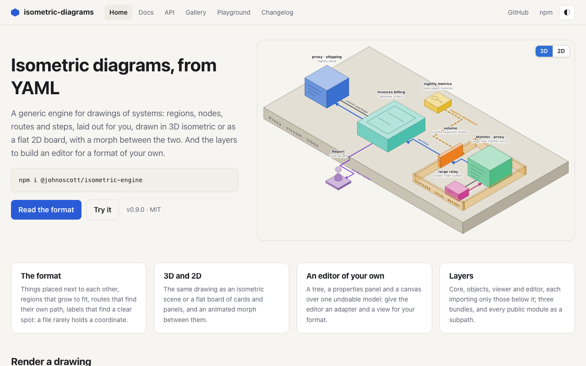

# isometric-diagrams

**[Docs, gallery and playground →](https://johnoscott.github.io/isometric-diagrams/)**

[](https://johnoscott.github.io/isometric-diagrams/)

A generic isometric diagram engine. Describe a system in YAML (regions such as hosts, fences and clouds; nodes such
as services, files and keys in them; routes between them; steps that animate them) and get a page that draws it in 3D
isometric or as a flat 2D board, with a morph between the two. The same layers give you an editor: a tree, a
properties panel and a canvas over one undoable model, for a format of your own.

**The package:** [`@johnoscott/isometric-engine`](https://www.npmjs.com/package/@johnoscott/isometric-engine) on npm, MIT.

```sh
npm i @johnoscott/isometric-engine
```

An example app built on it: the [isometric cloud editor](https://johnoscott.github.io/isometric-cloud-editor/).

## A drawing

```yaml
isodiag: 1
title: Hello
scenes:
  - id: s
    title: A request and its answer
    regions:
      - id: host
        kind: slab
        label: "APP HOST"
        nodes:
          - { id: web, asset: server, role: lead, label: web, sub: the front end }
          - { id: api, asset: chat, right-of: web, gap: 4, label: api server }
    routes:
      - { id: w-a, from: web, to: api, kind: send, label: request }
      - { id: a-w, from: api, to: web, kind: reply }
    steps:
      - { heading: The web asks the api, kind: send, animate: [w-a], pulse: [api] }
      - { heading: The api answers, kind: reply, animate: [a-w], pulse: [web] }
```

Things are placed next to each other (`right-of`, `below`, `in`) and regions grow to fit them. Routes find their own
path, and labels find a clear spot, so a file rarely holds a coordinate. `grid: { snap: 0.5 }` puts every edge on a
grid; `assemble: true` makes a scene build itself, piece by piece, when it comes into view.

## Commands

Needs Node 22.6 or later. Screenshots and the browser tests use Google Chrome if one is installed (`CHROME=/path`).

```sh
npm ci
node bin/isodiag.mjs check examples/demo.yaml              # validate and lay out; every problem with its line
node bin/isodiag.mjs build examples/demo.yaml -o demo.html # one standalone page: inline JS, CSS and SVG, no network
node bin/isodiag.mjs dev examples/demo.yaml                # serve it on 127.0.0.1 and reload on save
node bin/isodiag.mjs proof corpus/messaging.yaml -o messaging.proof.html   # a proof sheet: every object, every step
npm run build-iso                                          # the package, into dist-iso/
npm run build-site                                         # the documentation site, into site/
```

## The layers

| Layer | Folder | What it is |
|---|---|---|
| L0 core | `src/iso-core/` | The kernel: isometric geometry, metrics, themes, YAML parsing with positions, schema errors in plain words. |
| L1 objects | `src/iso-objects/` | Kinds as data, placement, routing, labels, steps, the 2D board layout; a drawing compiled to SVG. |
| L2 viewer | `src/iso-viewer/` | Pages and the player, the 2D view and the 3D \| 2D morph. |
| L3 editor | `src/iso-editor/` | The editor: the model, commands, the domain adapter, the views, `mountEditor` and `setupFor`, a plain skin. |
| P systems | `src/iso-systems/` | The drawing format `isodiag/1`: its catalogue of region and node kinds, its schema, `compile`. |

Each layer imports only the layers below it, through their public modules; [docs/LAYERS.md](docs/LAYERS.md) has the rules
and the public modules. The engine draws only its own marks: icons and screen faces beyond its own are a host's to
register (`objects.registerMarks`).

## Documentation

- [docs/FORMAT.md](docs/FORMAT.md): the YAML format, with examples. Its JSON Schema is `src/iso-systems/schema.json`.
- [docs/ASSETS.md](docs/ASSETS.md): every node and region kind with a picture, colour roles and decorations.
- [docs/EDITOR-GUIDE.md](docs/EDITOR-GUIDE.md): writing an editor of your own on the engine (shipped in the package).
- [docs/FLAT-VIEW.md](docs/FLAT-VIEW.md): the 2D view, the board layout and the morph.
- [docs/MOTION.md](docs/MOTION.md): motion as a function of time, for video and pages: documents and their Timeline, assemble and disassemble.
- [CHANGELOG.md](CHANGELOG.md).

## Tests

```sh
npm test            # unit tests in parallel, then the browser tests one at a time, each with its own profile
npm run typecheck
```

They cover validation messages and positions, layout and routing, the corpus (`corpus/`, `examples/`): clean builds,
no overlapping footprints, labels clear of each other at every step, SVG and PNG snapshots, the baseline of every
output (`scripts/baseline.ts`), the layers' boundaries, the 2D view and the morph, the editor in Chrome, and the
package: its exports, its declarations against a consumer, and its tarball.

## Limits

- Text widths come from a table measured with system-ui (SF Pro) and SF Mono on macOS. Elsewhere the fonts differ, so
  labels can sit a few pixels off; `node scripts/measure-fonts.mjs` remeasures.
- The router is orthogonal and floor-level; routes cross where they must. `via` and `points` give full control.

## Licence

MIT, in [LICENSE](LICENSE). The package bundles yaml (ISC), Lucide icons (ISC) and code generated by ajv (MIT); their
notices are in [LICENSES/](LICENSES/).
