# Assets

Every picture shows the asset in the light theme on the left and the dark theme on the right. They are made by
`node --experimental-strip-types scripts/asset-pics.ts`, from the same code that draws diagrams.

An asset is drawn in its node's **box** (`size: [w, d, h]` in grid units; each asset has a default) and coloured by
its **role** (`role:`; each asset has a default). A role gives a hue and saturation; the theme decides the lightness of
each face in light and dark, so every asset shades the same way.

## Node assets

Use with `asset: NAME` on a node. Add decorations to any box-shaped asset with `deco:` (see below).

| Asset | Picture | Default size `[w, d, h]` | Default role | What it is |
|---|---|---|---|---|
| `block` | 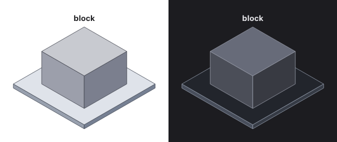 | 2.4 × 2.4 × 1.6 | `grey` | A box. Size and colour are free; the base for most things. The default asset. |
| `session` | 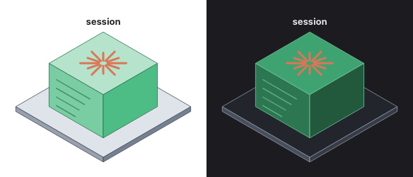 | 2.6 × 2.6 × 1.8 | `work` | An agent session: terminal lines on its front (`deco: [terminal: 4]`); a host's registered icon on top with `icon: NAME`. |
| `terminal` | 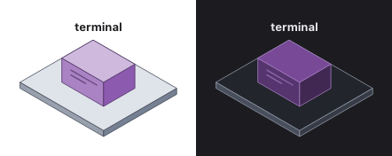 | 1.6 × 1.2 × 0.8 | `term` | A small box with terminal lines: a command, a listener, a dashboard. |
| `server` | 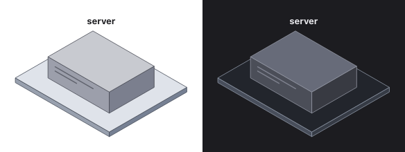 | 3 × 2.2 × 0.9 | `doz` | A daemon or service: a low box with two lines. |
| `chat` | 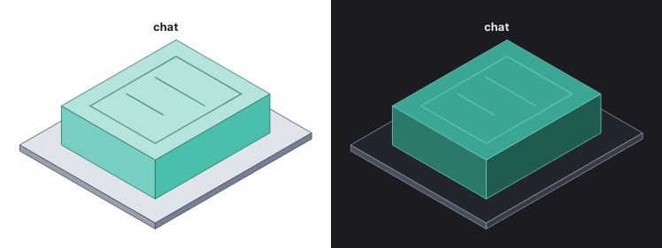 | 3.6 × 4.4 × 1.3 | `chat` | A chat server or room: a chat bubble on top. |
| `mailbox` | 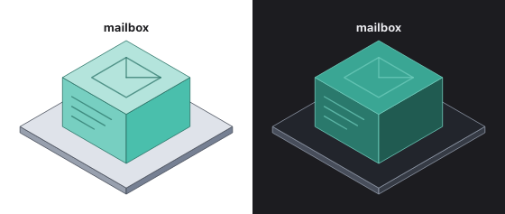 | 2.4 × 2.4 × 1.6 | `mail` | A room or inbox: terminal lines and an envelope on top. |
| `file` | 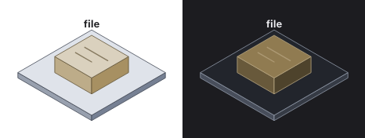 | 1.6 × 1.6 × 0.6 | `file` | A file or document: lines on top. |
| `folder` | 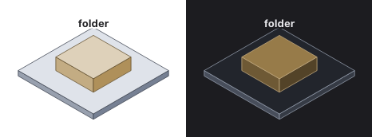 | 1.6 × 1.6 × 0.5 | `folder` | A folder: a flat box. Put `file` nodes on it with its own `nodes:`. |
| `key` | 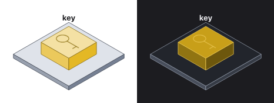 | 1.6 × 1.6 × 0.6 | `key` | A secret or keychain item: a key on top. |
| `socket` | 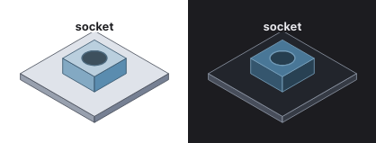 | 1.2 × 1.2 × 0.5 | `socket` | A socket: a round opening on top. |
| `gate` | 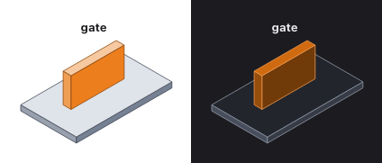 | 0.3 × 2 × 1.1 | `gate` | A gate or proxy: a narrow upright slab. Name it as a fence's `gate.node` and the fence places it in its wall. |
| `placeholder` | 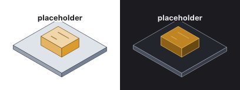 | 1.2 × 1.0 × 0.45 | `placeholder` | A placeholder value: a small box with lines. |
| `cloud` | 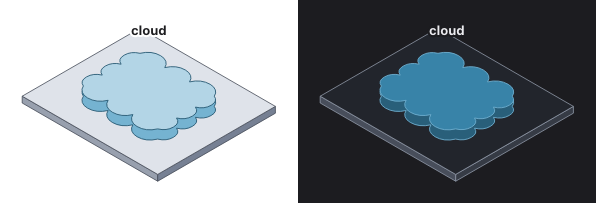 | 3 × 2.4 × 0.3 | `cloud` | A cloud lying on the floor: the internet, a hosted service. |
| `orb` | 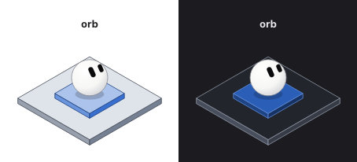 | 1.5 × 1.5 × 1.6 | `lead` | An agent as a character: a white sphere with eyes, on a plate coloured by its role. |
| `person` | 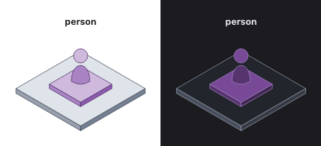 | 1.5 × 1.5 × 1.6 | `person` | A human. Its label sits to the right. |
| `screen` | 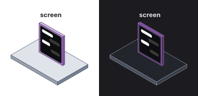 | 1.64 × 0.3 × 1.75 | `term` | An upright screen. `face:` `terminal` (default), `chat`, `desktop`, `tiles` (a grid of terminals), or a face the host registers; `facing:` turns it (degrees). |
| `monitor` | 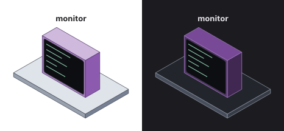 | 2.4 × 0.8 × 1.8 | `term` | A block with a screen painted on its front-left face; `face:` as for `screen`. |
| `volume` | 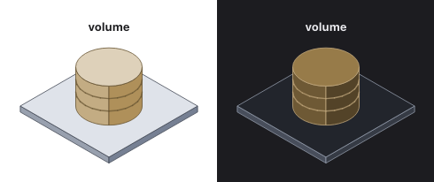 | 1.8 × 1.8 × 1.3 | `folder` | Stored data that is kept: a drum with two bands. A volume, a store's history, an archive. |

### Decorations

`deco:` is a list; each item is a word or a one-key map:

| Decoration | Where | Example |
|---|---|---|
| `terminal` or `terminal: N` | N lines (1–8, default 3) on the front-left face | `deco: [terminal: 4]` |
| `icon: NAME` | An icon the host registers (`objects.registerMarks`), laid flat on the top face; none is built in (0.9.0). A name nothing registered draws a dashed placeholder, and the compile warns | `deco: [icon: NAME]` |
| `envelope` | An envelope on top | `deco: [envelope]` |
| `bubble` | A chat bubble on top | `deco: [bubble]` |
| `file-lines` | Two lines of text on top | `deco: [file-lines]` |
| `ghost` | Dashed outline only: stopped, or not built (same as `ghost: true`) | `ghost: true` |

An asset's own decorations are replaced when a node gives `deco:`.

## Region kinds

Use with `kind:` on a region. A region without `size` grows to fit what is in it, plus `padding`.

| Kind | Picture | Height | Label | What it is |
|---|---|---|---|---|
| `slab` | 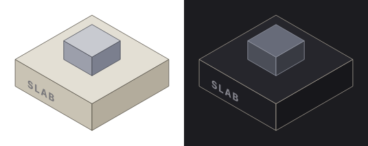 | thick base, top at 0.35 | On its front face | A machine: "app host". Padding 1.2. |
| `pad` | 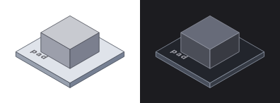 | 0.2 | On the floor | A small plate for someone's things: a person and their screens. |
| `vm` | 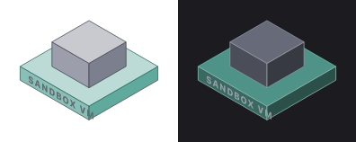 | 0.45, tinted | On its front face | A sandbox: a raised plate; its contents stand on it. |
| `platform` | 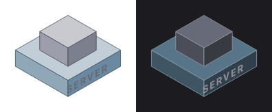 | 0.7, tinted | On its right face | A server holding parts: rooms, a directory. Routes climb onto it. |
| `fence` | 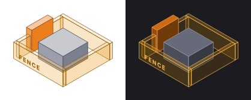 | walls 0.8 | On its front wall | A cage: translucent walls, back walls behind its contents and front walls over them. `gate: { side, at, width, height, node }` opens one wall and puts a node in it. |
| `cloud` | 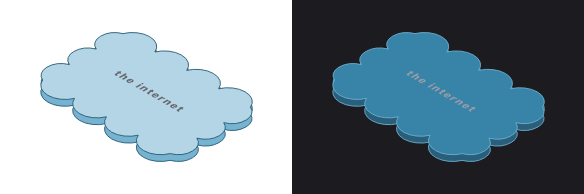 | 0.2 | On the floor | An area of the internet or a hosted service. |
| `zone` | 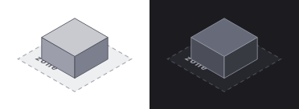 | flat | On the floor | A tinted area with a dashed edge: grouping without a surface. |
| `tunnel` | 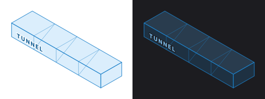 | 0.8, lifted by `z` | Along its side | A translucent tube, such as a Tailscale tunnel. `around: [route ids]` lights it with those routes. |

## Colour roles

Roles are hue and saturation pairs in the theme (`themes/default.yaml`, `roles:`): `slab`, `pad`, `lead` (blue),
`work` (green), `violet`, `doz` / `grey` / `cursor` (grey), `chat` / `mail` (teal), `file`, `folder`, `key`, `gate`,
`cloud`, `event` (pink), `placeholder`, `term` / `person` (purple), `socket`, `fence`, `sandbox`, `server`, `belt`,
`bot`, `blue`, `green`. A file adds its own under `roles:`:

```yaml
roles:
  brand: { h: 12, s: 70 }            # hue 0–360, saturation 0–100
  glass: { h: 205, s: 40, tint: 15 } # top face: 15% of the colour mixed into the pad colour
```

## Adding an asset

An asset is a TypeScript object in `src/iso-systems/nodes.ts` (or its own file), added to `NODE_ASSETS`:

```ts
const antenna: NodeAsset = {
  name: 'antenna',
  description: 'A radio mast on a small base.',
  size: [1.2, 1.2, 2.4],          // default box, grid units
  role: 'grey',                   // default colour role
  draw(k, b, n) {                 // k: the kernel, b: the node's box, n: the node from the YAML
    const base = { ...b, z1: b.z0 + 0.3 };
    const [cx, cy] = [(b.x0 + b.x1) / 2, (b.y0 + b.y1) / 2];
    return k.blockFaces(base) + k.line3([cx, cy, base.z1], [cx, cy, b.z1], 'det');
  },
  // optional: label(b, n, hasSub) to move its label, pulse(b) to place its step pulse
};
```

The kernel (`src/iso-core/kernel.ts`) gives `iso(x, y, z)`, `blockFaces(box)` (the three shaded faces with the reference
classes), `poly`, `line3`, `onFace(box, 'top' | 'left' | 'right', draw)` to paint in a face's own 2D pixel space, and
`floorText` / `faceText`. Use the classes `top`, `lft`, `rgt` for faces and `det` for detail lines, and the theme does
the rest. Then add a row to this file and run `scripts/asset-pics.ts`.
